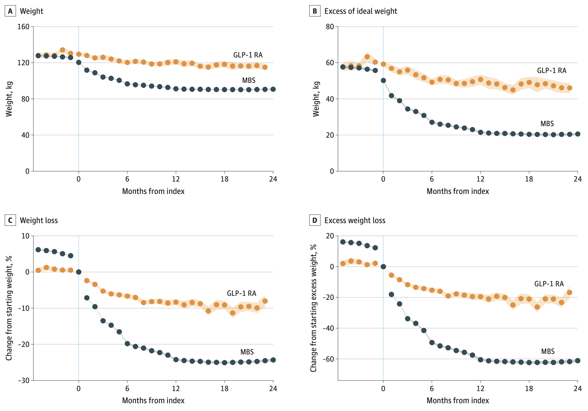
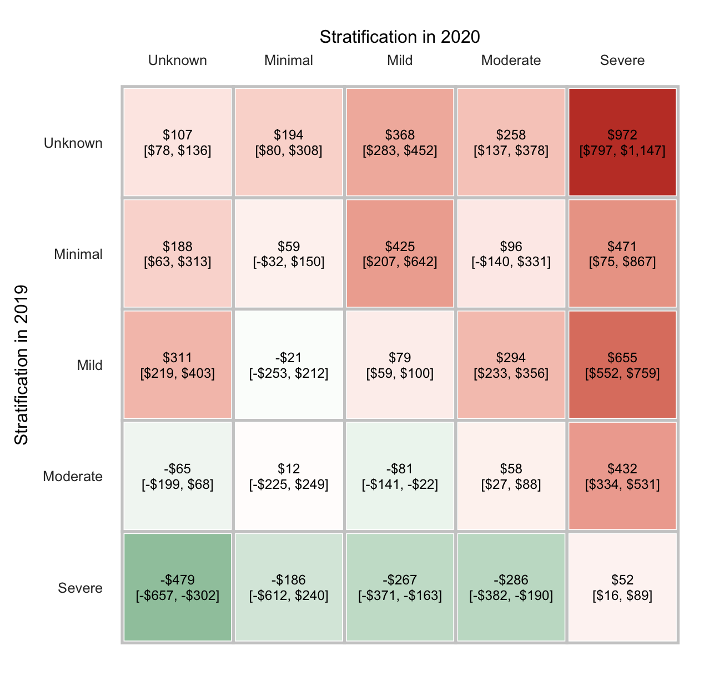

```{python}
#| echo: false
import numpy as np
import pandas as pd
import statsmodels.api as sm
import statsmodels.formula.api as smf
import matplotlib.pyplot as plt
from plotnine import *
from IPython.display import Markdown

# --- palette (matches custom.scss) ---
ACCENT, DARK, BLUE, YELLOW, RED = "#02577B", "#01364C", "#99D9DD", "#F4BA02", "#B23A48"
PAPER = "#ffffff"
theme_set(
    theme_minimal(base_size=13) +
    theme(
        figure_size=(7.5, 4.2), dpi=150,
        text=element_text(color=DARK),
        panel_grid_minor=element_blank(),
        panel_grid_major=element_line(color="#dfe3e6", size=0.4),
        plot_background=element_rect(fill=PAPER, color=PAPER),
        panel_background=element_rect(fill=PAPER, color=PAPER))
)
pd.set_option("display.width", 120, "display.max_columns", 12)
```

## {background-image='images/QuintupleAim.png' background-size='contain' background-color="#102A2C"}

<!-- Healthcare analytics is the use of the extensive data in healthcare to help with the Quintuple Aim -->

# Let's talk jobs! {background-color="#01364C"}

## The Field Is Growing

```{python}
#| echo: false
bls = pd.DataFrame({
    "role": ["Data scientists", "Medical & health\nservices managers", "Health info technologists\n& medical registrars",
             "Operations research\nanalysts", "Statisticians", "All occupations"],
    "growth": [35, 24, 16, 12, 11, 3],
    "openings": [24_800, 62_300, 3_000, 7_500, None, None],
    "pay": [120_230, 123_860, 68_020, 88_940, 105_650, None],
})
bls["lab"] = [f"{g}%" + (f"  ·  ${p/1000:.0f}k median" if p == p and p else "") for g, p in zip(bls["growth"], bls["pay"])]
bls["hl"] = np.where(bls["role"] == "All occupations", "avg", "role")
(
    ggplot(bls, aes("reorder(role, growth)", "growth", fill="hl"))
    + geom_col(width=0.65, show_legend=False)
    + geom_text(aes(label="lab"), ha="left", nudge_y=0.8, size=10, color=DARK)
    + scale_fill_manual(values={"role": ACCENT, "avg": "#BBBBBB"})
    + coord_flip() + ylim(0, 52)
    + labs(x="", y="Projected employment growth, 2025–2035 (%)",
           caption="Source: U.S. BLS Occupational Outlook Handbook (2025–35 projections; May 2025 pay)")
    + theme(figure_size=(8.5, 4.3))
)
```

**Insurance carriers** are among the top employers of data scientists (10%).

:::{.callout-note}
These are projections and are most certainly impacted by AI and other market changes.
:::

## Where the Jobs Are

::::{.columns}
:::{.column width="50%"}
**Payers (insurers)**
: Claims, cost of care, risk adjustment, HEDIS / Star ratings

**Providers (health systems)**
: EHR reporting, quality, operations, readmissions

**Pharma & life sciences**
: Real-world evidence, outcomes research
:::
:::{.column width="50%"}
**Health tech & data vendors**
: Products built on claims / SDOH data

**Consulting**
: Value-based care, program evaluation

**Government & public health**
: Medicaid, state health departments, CDC
:::
::::

<br>

:::{.callout-note}
**In Utah:** Intermountain Health / Select Health, University of Utah Health, Optum, HealthEquity, Regence BCBS, Utah DHHS, County Dept of Health
:::

## What Postings Ask For {.smaller}

*From seven real postings (accessed Oct 16, 2026).*

::::{.columns}
:::{.column width="33%"}
**Provider Data Analyst**<br>*Intermountain Health (2 postings)*

- **SQL**, database design; **Python and/or R**
- **Epic Clarity** / Cerner data
- Dashboards for clinical leaders
- Present findings to clinical & business teams
- BS + 2 yrs · $39–68/hr
:::
:::{.column width="33%"}
**Payer / Claims Analyst**<br>*Optum · USM (HEDIS)*

- Cost, utilization & reimbursement trends in **claims**
- **HEDIS** measures, care gaps, audits
- **SQL**, SAS, Tableau / Power BI, Excel
- Medicare, Commercial, Medicaid payment models
- BS + 3 yrs · $92k–164k (Optum)
:::
:::{.column width="33%"}
**Health Data Scientist**<br>*Cohere Health · Dandelion Health · GDIT*

- **Causal inference** with claims, EHR & SDOH data
- ML / AI on Medicare & Medicaid **claims**
- **ICD, CPT, NDC** codes
- **Python, R, SQL**, Spark
- MS+ (or BS + 5 yrs) · $98k–155k
:::
::::

<br>

::: {.fragment}
**Common thread:** SQL + a language + healthcare data fluency + **explaining results to non-analysts.**
:::

<small>Postings: Intermountain Health, *Data Analyst, Statistical Senior* and *Data Analyst-Technical-Staff*; Optum, *Senior Healthcare Analytics Consultant*; USM, *HEDIS Data Analyst (SQL)*; Cohere Health, *Senior Data Scientist*; Dandelion Health, *Research Consultant, Data Scientist*; GDIT, *Sr. Healthcare Data Scientist (Medicare/Medicaid)*. Links in Sources.</small>


# What Did I Do in Healthcare Analytics? {background-color="#01364C"}


## GLP-1s vs Bariatric Surgery {.smaller}

::::{.columns}
:::{.column width="60%"}

:::
:::{.column width="40%"}
**Data:** Highmark claims + AHN EHR (weights)

**Design:** 30,458 patients with class II/III obesity; propensity-score weighting; mixed-effects models for monthly cost

**Findings (2 yrs):**

- Weight loss: **28.3%** surgery vs **10.3%** GLP-1
- Total cost: **$51,794** surgery vs **$63,483** GLP-1
- Driver: ongoing pharmacy spend

<small>Barrett et al. (2025). *JAMA Surgery*, 160(11), 1232–1239.</small>
:::
::::

## Depression: Finding It and Costing It {.smaller}

::::{.columns}
:::{.column width="50%"}

:::
:::{.column width="50%"}
**Identify & stratify** with claims + EHR (Dx, Rx, PHQ-9, utilization)

- Found **720,882** members with depression
- **258,206 more** than diagnosis codes alone

**Cost of severity change** (PMPM, 2019 → 2020)

- Severity ↑ : **+$608** PMPM on average
- Severity ↓ : **−$41** PMPM

<small>Popkov, Barrett, et al. (2026). *J Behav Health Serv Res*; Popkov, Barrett, et al. (2025). *J Affect Disord*, 368, 41–47.</small>
:::
::::

You'll try a mini version of this with diabetes in the hands-on section.

## Palliative Care: Payor-Provider Partnership

```{python}
#| echo: false
pal = pd.DataFrame({"category": ["Total cost of care", "Inpatient", "Professional", "Skilled nursing",
                                 "Outpatient", "Inpatient rehab"],
                    "savings": [7160, 5672, 1243, 1049, 229, 216]})
(ggplot(pal, aes("reorder(category, savings)", "savings"))
 + geom_col(fill=ACCENT, width=0.6)
 + geom_text(aes(label="savings.map('${:,.0f}'.format)"), ha="left", nudge_y=150, color=DARK)
 + coord_flip() + ylim(0, 8500)
 + labs(x="", y="Lower cost vs matched controls ($ per member)",
        caption="614 Medicare Advantage members vs 614 matched; difference-in-differences")
 + theme(figure_size=(8, 3.8)))
```

**$4.5M** total savings · hospice use **84% vs 50%** · Jaffe, …, Barrett (2025). *J Palliat Med*.

## More from the Same Toolkit {.smaller}

| Question | Data | Method | Finding |
|---|---|---|---|
| Is adolescent depression screening equitable? | Claims + **SVI** | Multilevel logistic | Higher SVI → lower screening odds; pediatricians OR = 9.6 |
| What does insomnia cost? | Claims, ~3M members | Propensity matching, GLMs | 9% have insomnia, **21%** of total spend |
| Does measurement-based care reduce ED use? | Claims + registry | Negative binomial, survival | **34% lower** ED visit rate (IRR = 0.66) |

<small>Galper et al. (2025) *AJPH*; Karlin et al. (2024) *Sleep Adv*; Breitzig et al. (2026) *Adm Policy Ment Health*.</small>

::: {.fragment}
Every one started as a **business question** from a clinical or finance partner.
:::


# The Healthcare Data Landscape {background-color="#01364C"}

## The Data

Highmark is a **payor-provider** system: an insurer (Highmark) *and* a health network (Allegheny Health Network). Similar to Intermountain Health.

```{python}
#| echo: false
pubs = pd.DataFrame({
    "study": ["GLP-1 vs bariatric surgery\n(JAMA Surg 2025)", "Depression severity & cost\n(J Affect Disord 2025)",
              "Depression ID framework\n(J Behav Health Serv Res 2026)", "Palliative care program\n(J Palliat Med 2025)",
              "Adolescent depression screening\n(Am J Public Health 2025)", "Insomnia prevalence & cost\n(Sleep Adv 2024)",
              "Measurement-based care & ED\n(Adm Policy Ment Health 2026)"],
    "Claims": [1, 1, 1, 1, 1, 1, 1], "EHR / clinical": [1, 1, 1, 0, 0, 0, 1],
    "Census / SVI": [0, 0, 0, 0, 1, 0, 0], "Derived / vendor": [0, 1, 1, 0, 1, 0, 0],
})
long = pubs.melt("study", var_name="source", value_name="used")
long["used"] = long["used"].astype(str)
long["source"] = pd.Categorical(long["source"], ["Claims", "EHR / clinical", "Census / SVI", "Derived / vendor"])
long["study"] = pd.Categorical(long["study"], pubs["study"][::-1])
(
    ggplot(long, aes("source", "study", fill="used"))
    + geom_tile(color="white", size=1.5)
    + scale_fill_manual(values={"0": "#EEF1F3", "1": ACCENT}, guide=None)
    + labs(x="", y="")
    + theme(figure_size=(8.5, 4.4), panel_grid_major=element_blank(), axis_text_x=element_text(weight="bold"))
)
```


## Four Sources, Four Lenses {.smaller}

| | **Claims** | **EHR** | **Public / Census** | **Vendor** |
|---|---|---|---|---|
| **What** | Bills sent to an insurer | Clinical record of care | ACS, CDC SVI, PLACES | Purchased SDOH, consumer, benchmark data |
| **Grain** | One row per service line | One row per encounter / lab / vital | One row per ZIP, tract, county | One row per person (if matched) |
| **Owner** | Payers (Highmark, Medicaid) | Providers (Epic, Cerner) | Government | Data companies |
| **Strength** | Complete *billed* picture across all providers, with **cost** | Clinical detail: labs, vitals, PHQ-9 | Free, broad context | Fills social gaps |
| **What in the H\*ck?!** | No results, codes ≠ truth, reversals | Only *in-network* care, messy entry | Area ≠ person (ecological) | Match rates, black-box methods |

## How They Link {.big-mermaid}

```{mermaid}
%%| echo: false
%%| fig-width: 10
flowchart LR
  M["<b>members</b><br>member_id · zip · plan"]
  C["<b>claims</b><br>member_id · dx · $"]
  X["<b>mrn_crosswalk</b><br>mrn ↔ member_id"]
  E["<b>ehr_encounters</b><br>mrn · bmi · a1c · phq9"]
  Z["<b>census_zip</b><br>zip · svi · income"]
  V["<b>vendor_sdoh</b><br>member_id · food insecurity"]
  C -- member_id --> M
  E -- mrn --> X -- member_id --> M
  Z -- zip --> M
  V -- "member_id<br>(83% match)" --> M
  classDef hub fill:#01364C,color:#fff,stroke:#01364C
  classDef t fill:#F5F5F5,stroke:#01364C,color:#01364C
  class M hub
  class C,X,E,Z,V t
```

**The hardest part of healthcare analytics is usually the joins and data prep, not the model.**


# Hands-On: "Juniper Health Plan Data" {background-color="#01364C"}

## Meet the Data {.smaller}

*Juniper Health Plan* is **fictitious** — 3,000 Utah members in 2025.

```{python}
claims  = pd.read_csv("data/claims.csv", parse_dates=["service_date"])
members = pd.read_csv("data/members.csv", parse_dates=["enroll_start", "enroll_end"])
ehr     = pd.read_csv("data/ehr_encounters.csv", parse_dates=["encounter_date"])
xwalk   = pd.read_csv("data/mrn_crosswalk.csv")
census  = pd.read_csv("data/census_zip.csv", dtype={"zip": str})
vendor  = pd.read_csv("data/vendor_sdoh.csv")
members["zip"] = members["zip"].astype(str)
members["age"] = 2025 - members["birth_year"]
```

```{python}
#| echo: false
pd.Series({k: len(v) for k, v in dict(claims=claims, members=members, ehr=ehr,
           xwalk=xwalk, census=census, vendor=vendor).items()}, name="rows")
```

# Claims {background-color="#02577B"}

## What a Claim Looks Like {.smaller}

```{python}
(
    claims
    .sample(6, random_state=3)
    [["member_id", "service_date", "place_of_service", "dx1", "procedure_or_drug", "paid_amt"]]
    .reset_index(drop=True)
)
```

- `dx1` = ICD-10 diagnosis · `procedure_or_drug` = CPT code or drug class
- `place_of_service` tells you *where*: office, ED (23), inpatient (21), telehealth (02)

## What in the H*ck?! Reversals {.smaller}

Claims get reversed and resubmitted. Sum dollars **by claim** before anything else.

```{python}
claims["claim_status"].value_counts()
```

```{python}
net = (
    claims
    .groupby(["claim_id", "member_id", "service_date", "claim_type",
              "place_of_service", "dx1", "procedure_or_drug"], dropna=False)
    [["allowed_amt", "paid_amt"]]
    .sum()
    .reset_index()
)
net = net[net["paid_amt"] > 0]          # fully reversed claims drop out
len(claims), len(net)
```

## PMPM: The Payer's Favorite Metric {.smaller}

**P**er **M**ember **P**er **M**onth = total paid ÷ member-months

::::{.columns}
:::{.column width="52%"}
```{python}
paid = net.groupby("member_id")["paid_amt"].sum()
mem = members.assign(
    paid=members["member_id"].map(paid).fillna(0))

pmpm = (
    mem
    .groupby("plan_type")
    [["paid", "member_months"]]
    .sum()
)
pmpm["pmpm"] = pmpm["paid"]/pmpm["member_months"]
pmpm["pmpm"].round(0)
```

:::
:::{.column width="48%"}
```{python}
#| echo: false
(
    ggplot(pmpm.reset_index(), aes("reorder(plan_type, pmpm)", "pmpm"))
    + geom_col(fill=ACCENT, width=0.6)
    + geom_text(aes(label="pmpm.map('${:,.0f}'.format)"), va="bottom", nudge_y=5, color=DARK)
    + labs(x="", y="Paid PMPM ($)")
    + theme(figure_size=(5, 4.4))
)
```

:::
::::

Why divide by member-months? Not everyone is enrolled all year.

## Cost Is Concentrated

```{python}
#| echo: false
spend = (
    net
    .groupby("member_id")["paid_amt"]
    .sum()
    .reindex(members["member_id"], fill_value=0)
    .sort_values(ascending=False).reset_index()
)
spend["pct_members"] = np.arange(1, len(spend) + 1) / len(spend) * 100
spend["pct_spend"] = spend["paid_amt"].cumsum() / spend["paid_amt"].sum() * 100
top5 = spend.loc[spend["pct_members"] <= 5, "pct_spend"].max()
top20 = spend.loc[spend["pct_members"] <= 20, "pct_spend"].max()
```

The top **5%** of members account for **`{python} f"{top5:.0f}%"`** of spend; the top 20% for **`{python} f"{top20:.0f}%"`**.

```{python}
#| echo: false
(
    ggplot(spend, aes("pct_members", "pct_spend"))
    + geom_area(fill=BLUE, alpha=0.6) + geom_line(color=DARK, size=1)
    + geom_abline(linetype="dashed", color="grey")
    + annotate("point", x=5, y=top5, color=RED, size=4)
    + annotate("text", x=8, y=top5 - 6, label=f"Top 5% → {top5:.0f}% of $", ha="left", color=RED)
    + labs(x="% of members (highest cost first)", y="Cumulative % of spend")
)
```

This is why care management programs target "high utilizers."

## Where Does the Money Go? {.smaller}

```{python}
by_pos = (
    net
    .groupby("place_of_service")
    ["paid_amt"]
    .agg(["sum", "size"])
)
by_pos["share_of_$"] = by_pos["sum"] / by_pos["sum"].sum()
by_pos["share_of_claims"] = by_pos["size"] / by_pos["size"].sum()
```

::::{.columns}
:::{.column width="50%"}
```{python}
#| echo: false
by_pos[["share_of_claims", "share_of_$"]].round(2)
```

:::
:::{.column width="50%"}
```{python}
#| echo: false
long = (
    by_pos[["share_of_claims", "share_of_$"]]
    .reset_index()
    .melt("place_of_service", var_name="measure", value_name="share")
)
long["measure"] = long["measure"].map({"share_of_claims": "% of claims", "share_of_$": "% of dollars"})
(
    ggplot(long, aes("reorder(place_of_service, share)", "share", fill="measure"))
    + geom_col(position="dodge", width=0.7)
    + coord_flip()
    + scale_fill_manual(values={"% of claims": BLUE, "% of dollars": DARK})
    + scale_y_continuous(labels=lambda l: [f"{x:.0%}" for x in l])
    + labs(x="", y="", fill="")
    + theme(figure_size=(5.2, 4.4), legend_position="bottom")
)
```

:::
::::

Inpatient: few claims, big dollars. Pharmacy: most claims, dollars driven by a few drugs.

## Your Turn: Claims {.smaller background-color="#F7F8F9"}

:::{.callout-tip}
## 5 minutes
1. Which **diagnosis codes** (`dx1`) show up most in ED visits (`place_of_service == "23 Emergency Room"`)?
2. What share of pharmacy dollars goes to **GLP-1 RA**? How many members fill one?
:::

::: {.fragment}
```{python}
ed = net[net["place_of_service"].str.startswith("23")]
print(ed["dx1"].value_counts().head(3))
```

:::

::: {.fragment}
```{python}
rx = net[net["claim_type"] == "pharmacy"]
print(rx.groupby("procedure_or_drug")["paid_amt"].sum().div(rx["paid_amt"].sum()).round(2).sort_values().tail(3))
print("Members filling a GLP-1:", rx.loc[rx["procedure_or_drug"] == "GLP-1 RA", "member_id"].nunique())
```

:::


# Electronic Health Records {background-color="#02577B"}

## Linking EHR to Claims

EHRs use a **medical record number (MRN)**, not a member ID. We need a crosswalk.

```{python}
ehr_m = ehr.merge(xwalk, on="mrn", how="left")
cov = members["member_id"].isin(ehr_m["member_id"]).mean()
```

```{python}
#| echo: false
print(f"{cov:.0%} of members have any EHR data")
```

The rest got care **outside** this health system: the EHR only sees in-network care.

## What in the H*ck?! Data Entry Errors

```{python}
#| echo: false
ehr_m["flag"] = np.where(ehr_m["bmi"].between(12, 70), "plausible", "implausible")
p1 = (
    ggplot(ehr_m.dropna(subset=["bmi"]), aes("bmi", fill="flag"))
    + geom_histogram(bins=80, color="white")
    + scale_x_log10()
    + scale_fill_manual(values={"plausible": ACCENT, "implausible": RED})
    + labs(x="BMI (log scale)", y="Encounters", fill="")
)
p1
```

```{python}
ehr_m.loc[~ehr_m["bmi"].between(12, 70), "bmi"] = np.nan   # set impossible values to missing
```

## Who Has Diabetes? Depends Who You Ask {.smaller}

::::{.columns}
:::{.column width="55%"}
```{python}
dx  = set(net.loc[net["dx1"] == "E11.9", "member_id"])
rx  = set(net.loc[net["procedure_or_drug"] == "metformin", "member_id"])
lab = set(ehr_m.loc[ehr_m["a1c"] >= 6.5, "member_id"])

def found_by(m):
    hits = [n for n, ids in [("Dx", dx), ("Rx", rx), ("Lab", lab)]
            if m in ids]
    return " + ".join(hits) or "none"

linked = ehr_m["member_id"].dropna().unique()
combo = (
    pd.Series([found_by(m) for m in linked])
    .value_counts()
    .drop("none")
)
```

:::
:::{.column width="45%"}
```{python}
#| echo: false
c = combo.rename_axis("source").reset_index(name="count")
c["fill"] = np.where(c["source"] == "Dx + Rx + Lab", "all", "partial")
(
    ggplot(c, aes("reorder(source, count)", "count", fill="fill"))
    + geom_col(show_legend=False) + coord_flip()
    + scale_fill_manual(values={"all": DARK, "partial": BLUE})
    + labs(x="Identified by", y="Members (EHR-linked)")
    + theme(figure_size=(4.6, 4.4))
)
```

:::
::::

Any single source **misses people**. Combining claims with EHR labs gives a fuller picture (the same idea as the Highmark depression framework).

## Your Turn: EHR {.smaller background-color="#F7F8F9"}

:::{.callout-tip}
## 5 minutes
Use each linked member's **highest PHQ-9** to assign depression severity (0–4 none/minimal, 5–9 mild, 10–14 moderate, 15–19 mod-severe, 20+ severe). How many with a PHQ-9 ≥ 10 have **no** depression diagnosis (`F32*`/`F33*`) in claims?
:::

::: {.fragment}
```{python}
phq = ehr_m.groupby("member_id")["phq9"].max().dropna()
sev = pd.cut(phq, [-1, 4, 9, 14, 19, 27], labels=["none", "mild", "moderate", "mod-severe", "severe"])
dep_dx = set(net.loc[net["dx1"].str.match(r"F3[23]", na=False), "member_id"])
high = phq[phq >= 10].index
```

```{python}
#| echo: false
print(sev.value_counts().sort_index().to_dict())
print(f"PHQ-9 ≥ 10 without a dx: {(~high.isin(dep_dx)).sum()} of {len(high)}")
```

:::

# Public / Census Data {background-color="#02577B"}

## Adding Neighborhood Context {.smaller}

The **Social Vulnerability Index (SVI)** ranks areas 0–1 on poverty, housing, transportation, etc.

```{python}
census.head(3)
```

```{python}
ed_n = ed.groupby("member_id").size().rename("ed_visits")
by_zip = (mem.merge(ed_n, on="member_id", how="left").fillna({"ed_visits": 0})
             .groupby("zip")[["ed_visits", "member_months"]].sum()
             .merge(census, on="zip"))
by_zip["ed_per_1000"] = 12_000 * by_zip["ed_visits"] / by_zip["member_months"]
```

## ED Visits Rise with Vulnerability

```{python}
#| echo: false
(
    ggplot(by_zip, aes("svi", "ed_per_1000"))
    + geom_smooth(method="lm", color=ACCENT, fill=BLUE, alpha=0.3)
    + geom_point(color=DARK, size=3)
    + geom_text(aes(label="county"), nudge_y=12, size=9, color=DARK)
    + labs(x="Social Vulnerability Index (ZIP)", y="ED visits per 1,000 member-years")
)
```

<br>

⚠️ **Ecological fallacy:** a ZIP's SVI describes the *area*, not the person.

# Vendor Data {background-color="#02577B"}

## Buying What You Can't Observe {.smaller}

Vendors link consumer records to members and sell **person-level** social risk.

::::{.columns}
:::{.column width="50%"}
```{python}
v = members[["member_id"]].merge(
    vendor, on="member_id", how="left")
conf = v["match_confidence"]
print(f"Matched:          {conf.notna().mean():.0%}")
print(f"High-confidence:  {(conf >= .7).mean():.0%}")
```

:::
:::{.column width="50%"}
```{python}
#| echo: false
(
    ggplot(vendor, aes("match_confidence"))
    + geom_histogram(bins=30, fill=ACCENT, color="white")
    + geom_vline(xintercept=0.7, color=RED, linetype="dashed")
    + annotate("text", x=0.69, y=230, label="keep ≥ 0.7 →", ha="right", color=RED, size=10)
    + labs(x="Vendor match confidence", y="Members")
    + theme(figure_size=(5, 3.8))
)
```

:::
::::

Ask every vendor: *how* did you match, *how* is this score built, and *who* is missing?

## Food Insecurity and the ED {.smaller}

::::{.columns}
:::{.column width="52%"}
```{python}
dat = (
    mem
    .merge(ed_n, on="member_id", how="left")
    .fillna({"ed_visits": 0})
    .merge(census, on="zip")
    .merge(vendor, on="member_id")
    .query("match_confidence >= 0.7")
)
dat["fi_q"] = pd.qcut(dat["food_insecurity_index"], 4, labels=["Q1 low", "Q2", "Q3", "Q4 high"])

q = (
    dat
    .groupby("fi_q", observed=True)
    [["ed_visits", "member_months"]]
    .sum()
)
q["per_1000"] = 12_000 * q["ed_visits"] / q["member_months"]
q["per_1000"].round(0)
```

:::
:::{.column width="48%"}
```{python}
#| echo: false
(
    ggplot(q.reset_index(), aes("fi_q", "per_1000"))
    + geom_col(fill=[BLUE, BLUE, ACCENT, DARK])
    + labs(x="Food insecurity index (quartile)", y="ED visits per 1,000 member-years")
    + theme(figure_size=(5, 4.4))
)
```

:::
::::

## Putting It All Together: A Poisson Model {.smaller}

ED visits are counts with unequal exposure, so use Poisson with an **offset** for member-months.

```{python}
dat["diabetes_dx"] = dat["member_id"].isin(dx).astype(int)
fit = smf.glm(
    "ed_visits ~ food_insecurity_index + svi + age + diabetes_dx + C(plan_type)",
    data = dat,
    family = sm.families.Poisson(),
    offset = np.log(dat["member_months"])
).fit()
```

```{python}
#| echo: false
irr = (pd.DataFrame({"irr": np.exp(fit.params), "lo": np.exp(fit.conf_int()[0]),
                     "hi": np.exp(fit.conf_int()[1])}).drop("Intercept").reset_index(names="term"))
irr["term"] = irr["term"].str.replace(r"C\(plan_type\)\[T\.(.*)\]", r"\1 (vs Commercial)", regex=True)
irr.loc[irr["term"] == "food_insecurity_index", ["irr", "lo", "hi"]] **= 10
irr["term"] = irr["term"].replace({"food_insecurity_index": "Food insecurity (+10 pts)",
                                   "svi": "SVI (0 → 1)", "age": "Age (+1 yr)", "diabetes_dx": "Diabetes dx"})
(
    ggplot(irr, aes("irr", "reorder(term, irr)"))
    + geom_vline(xintercept=1, linetype="dashed", color="grey")
    + geom_errorbarh(aes(xmin="lo", xmax="hi"), height=0.2, color=ACCENT)
    + geom_point(size=3, color=DARK)
    + scale_x_log10(breaks=[0.5, 0.75, 1, 1.5, 2, 3])
    + labs(x="Incidence rate ratio (log scale)", y="")
    + theme(figure_size=(7.5, 3.6))
)
```

## Your Turn: Vendor + Model {.smaller background-color="#F7F8F9"}

:::{.callout-tip}
## 5 minutes
1. Add `housing_instability` and `transportation_barrier` to the model. Do they matter after food insecurity?
2. Refit using **all** matched members (no confidence filter). Does the food-insecurity IRR change?
:::

::: {.fragment}
```{python}
#| eval: false
fit2 = smf.glm("ed_visits ~ food_insecurity_index + housing_instability + transportation_barrier"
               " + svi + age + diabetes_dx + C(plan_type)", data=dat,
               family=sm.families.Poisson(), offset=np.log(dat["member_months"])).fit()
np.exp(fit2.params).round(2)
```

:::


## Takeaways

1. **Claims** = cost & breadth · **EHR** = clinical depth · **Census** = context · **Vendor** = gaps filled (at a price)
2. Most of the work is **linking and cleaning**: reversals, crosswalks, implausible values, match rates
3. No single source finds everyone. **Combine them.**
4. The field is **growing**, and it rewards people who can *explain* results to clinicians and executives

:::{.callout}
**Keep playing:** all data is in `data/` and `data/make_data.py` regenerates it.
:::

## Sources: Background & Careers {.smaller}

- Nundy S, Cooper LA, Mate KS. The Quintuple Aim for health care improvement: a new imperative to advance health equity. *JAMA*. 2022;327(6):521–522. [PMID 35061006](https://pubmed.ncbi.nlm.nih.gov/35061006/)
- Job postings (accessed Oct 16, 2026): [Intermountain Health, Data Analyst, Statistical Senior](https://jobs.alooba.com/us/job/intermountain-health-data-analyst-statistical-senior-836248/) · [Intermountain Health, Data Analyst-Technical-Staff](https://builtin.com/job/data-analyst-technical-staff/3484345) · [Optum, Senior Healthcare Analytics Consultant](https://careers.unitedhealthgroup.com/job/richardson/sr-healthcare-consultant-physician-medicare-and-analytics-remote/34088/101934064752) · [USM, HEDIS Data Analyst (SQL)](https://talents.vaia.com/companies/usm/hedis-data-analyst-sql-144611449/) · [Cohere Health, Senior Data Scientist](https://job-boards.greenhouse.io/coherehealth/jobs/7520590003) · [Dandelion Health, Research Consultant, Data Scientist](https://jobs.primary.vc/companies/dandelion-health-inc/jobs/94195881-research-consultant-data-scientist) · [GDIT, Sr. Healthcare Data Scientist (Medicare/Medicaid)](https://www.gdit.com/careers/job/079df090a/sr-healthcare-data-scientist-medicaremedicaid/)
- U.S. Bureau of Labor Statistics, *Occupational Outlook Handbook*: [Data Scientists](https://www.bls.gov/ooh/math/data-scientists.htm), [Medical & Health Services Managers](https://www.bls.gov/ooh/management/medical-and-health-services-managers.htm), [Health Information Technologists](https://www.bls.gov/ooh/healthcare/health-information-technologists-and-medical-registrars.htm), [Operations Research Analysts](https://www.bls.gov/ooh/math/operations-research-analysts.htm), [Mathematicians & Statisticians](https://www.bls.gov/ooh/math/mathematicians-and-statisticians.htm)

## Sources: Highmark Work {.smaller}

- Barrett TS, et al. Obesity treatment with bariatric surgery vs GLP-1 receptor agonists. *JAMA Surg*. 2025;160(11):1232–1239. [PMID 40960852](https://pubmed.ncbi.nlm.nih.gov/40960852/)
- Popkov AA, Barrett TS, et al. Depression symptom severity and total cost of care. *J Affect Disord*. 2025;368:41–47. [PMID 39271070](https://pubmed.ncbi.nlm.nih.gov/39271070/)
- Popkov AA, Barrett TS, et al. Claims-based depression identification and stratification. *J Behav Health Serv Res*. 2026;53(2):237–253. [PMID 40962946](https://pubmed.ncbi.nlm.nih.gov/40962946/)
- Jaffe E, …, Barrett TS. Payor-provider partnership in palliative care. *J Palliat Med*. 2025;28(8):1079–1086. [PMID 40323731](https://pubmed.ncbi.nlm.nih.gov/40323731/)
- Galper K, …, Barrett TS, et al. Social vulnerability and depression screening. *Am J Public Health*. 2025;115(9):1436–1444. [PMID 40609057](https://pubmed.ncbi.nlm.nih.gov/40609057/)
- Karlin BE, …, Barrett TS. Insomnia in a payor-provider system. *Sleep Adv*. 2024;5(1):zpae054. [PMID 39372542](https://pubmed.ncbi.nlm.nih.gov/39372542/)
- Breitzig MT, …, Barrett TS, et al. Measurement-based care and ED visits. *Adm Policy Ment Health*. 2026;53(4):462–474. [PMID 42096017](https://pubmed.ncbi.nlm.nih.gov/42096017/)
