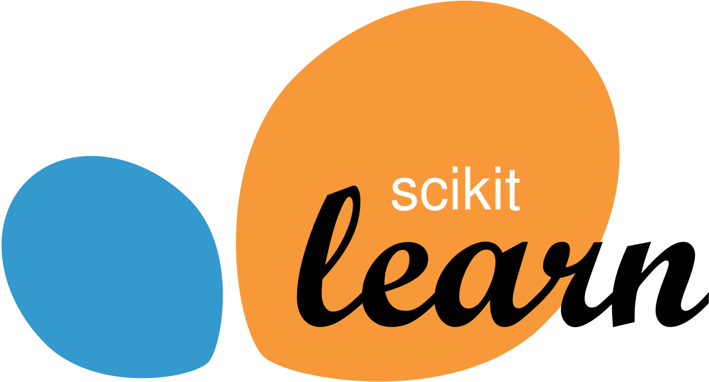
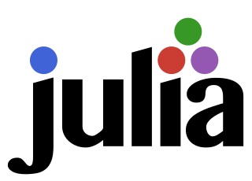
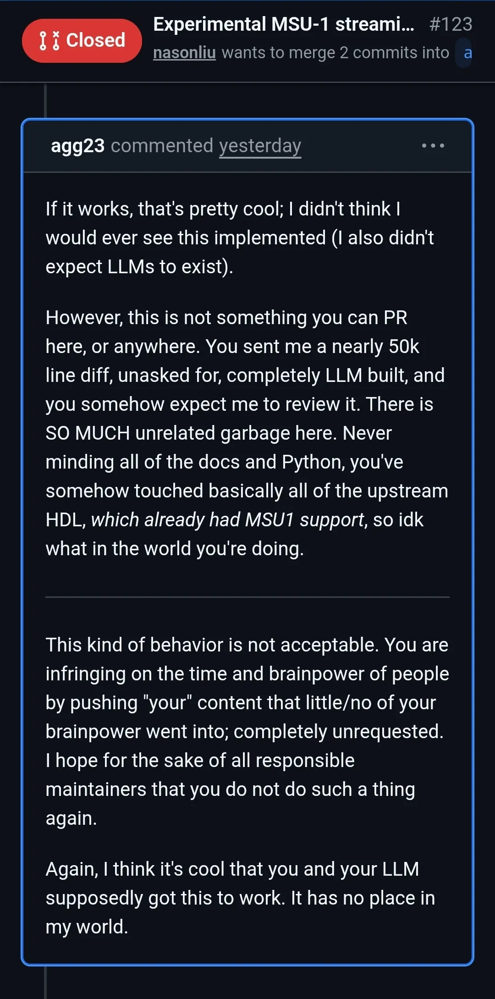

```{r}
#| label: setup
library(data.table)
library(ggplot2)

# Fallback values (pulled 2026-11-13). Live chunks below overwrite these
# when the network/packages are available at render time.
stats = list(
  version_cran   = "1.18.6",
  version_dev    = "1.18.99",
  authors_all    = 193L,
  authors_12mo   = 30L,
  new_12mo       = 15L,
  commits_12mo   = 252L,
  downloads_mo   = NA_real_,
  revdeps        = NA_integer_,
  stars          = NA_integer_,
  open_issues    = NA_integer_,
  open_prs       = NA_integer_
)

fmt = function(x) if (is.na(x)) "—" else format(x, big.mark = ",")
```

```{r}
#| label: live-stats
# CRAN downloads (last 30 days) — needs {cranlogs}
try({
  dl = cranlogs::cran_downloads("data.table", when = "last-month")
  stats$downloads_mo = sum(dl$count)
}, silent = TRUE)

# Direct reverse dependencies on CRAN
try({
  db = tools::CRAN_package_db()
  rd = tools::package_dependencies("data.table", db = db, reverse = TRUE,
                                   which = c("Depends", "Imports", "LinkingTo"))
  stats$revdeps = length(rd[[1]])
}, silent = TRUE)

# GitHub stars / open issues / open PRs — needs {gh} and a GITHUB_PAT
try({
  repo = gh::gh("/repos/Rdatatable/data.table")
  stats$stars = repo$stargazers_count
  stats$open_prs = gh::gh("/search/issues",
    q = "repo:Rdatatable/data.table type:pr state:open")$total_count
  stats$open_issues = gh::gh("/search/issues",
    q = "repo:Rdatatable/data.table type:issue state:open")$total_count
}, silent = TRUE)
```


## {background-color="#1f3b57"}


. . .


## Today's focus {.center}

::: {.fragment}
The history talk covered [how we got here]{.hl-muted}.
:::

::: {.fragment}
This talk is about [what is happening right now]{.hl-teal} and some hints about [where we're going]{.hl-amber}
:::


# Where we are {background-color="#1f3b57"}

## By the numbers

[Usage]{.stat-label}

:::: {.stat-grid}
::: {.stat .teal}
[`r fmt(stats$downloads_mo)`]{.num} [CRAN downloads, last month]{.lbl}
:::
::: {.stat .teal}
[`r fmt(stats$revdeps)`]{.num} [CRAN packages depend on it directly]{.lbl}
:::
::: {.stat .teal}
[`r fmt(stats$stars)`]{.num} [GitHub stars]{.lbl}
:::
::: {.stat .teal}
[0]{.num} [dependencies beyond base R]{.lbl}
:::
::::

[Development]{.stat-label}

:::: {.stat-grid}
::: {.stat .amber}
[`r stats$version_cran`]{.num} [on CRAN (`r stats$version_dev` in dev)]{.lbl}
:::
::: {.stat .amber}
[`r stats$authors_all`]{.num} [people have committed code, all time]{.lbl}
:::
::: {.stat .amber}
[`r stats$authors_12mo`]{.num} [committers in the last 12 months (`r stats$new_12mo` first-timers)]{.lbl}
:::
::: {.stat .amber}
[`r stats$commits_12mo`]{.num} [commits in the last 12 months]{.lbl}
:::
::::

```{r}
#| label: downloads-trend
#| fig-width: 12
#| fig-height: 1.7
#| eval: false
# Monthly downloads from the Posit CRAN mirror (cranlogs). Silently skipped
# if cranlogs/network are unavailable at render time.
trend = NULL
try({
  d = data.table::as.data.table(
    cranlogs::cran_downloads("data.table", from = "2016-01-01", to = Sys.Date() - 1))
  trend = d[, .(n = sum(count)), by = .(month = as.IDate(format(date, "%Y-%m-01")))]
  trend = trend[month < as.IDate(format(Sys.Date(), "%Y-%m-01"))]
}, silent = TRUE)
if (!is.null(trend) && nrow(trend) > 0) {
  print(
    ggplot(trend, aes(month, n)) +
      geom_area(fill = "#2a9d8f", alpha = 0.18) +
      geom_line(colour = "#2a9d8f", linewidth = 1) +
      scale_y_continuous(labels = scales::label_number(scale_cut = scales::cut_short_scale()),
                         n.breaks = 3) +
      labs(x = NULL, y = NULL,
           title = "Monthly CRAN downloads (Posit mirror), since 2016") +
      theme_minimal(base_size = 14) +
      theme(panel.grid.minor = element_blank(),
            plot.title = element_text(size = 12, colour = "#5b6573", face = "bold"))
  )
}
```


## Supporting Popular Packages

```{r}
#| label: revdep-packages
#| fig-width: 12
#| fig-height: 6.2
pk = data.table(
  pkg  = c("dtplyr", "plotly", "Hmisc", "prodlim", "flextable", "ModelMetrics",
           "xgboost", "DescTools", "fastDummies", "rlist", "rio",
           "modelsummary", "marginaleffects"),
  dl   = c(306927, 253181, 215002, 119576, 104318, 82254,
           72042, 65576, 61199, 49934, 42538, 37048, 36806),
  what = c("data.table backend for dplyr", "Interactive graphics",
           "Harrell's miscellaneous stats tools", "Product-limit survival estimation",
           "Tables for Word, PowerPoint and HTML", "Model performance metrics",
           "Gradient boosting", "Descriptive statistics", "Dummy-variable creation",
           "List manipulation", "Data import and export", "Regression tables",
           "Marginal effects")
)
pk[, label := paste0(format(dl, big.mark = ","), "  ·  ", what)]

ggplot(pk, aes(dl, reorder(pkg, dl))) +
  geom_col(fill = "#2a9d8f", width = 0.72) +
  geom_text(aes(label = label), hjust = 0, nudge_x = 5000,
            size = 4.6, colour = "#3a4350") +
  scale_x_continuous(expand = expansion(mult = c(0, 0.02)),
                     limits = c(0, max(pk$dl) * 1.8)) +
  labs(x = NULL, y = NULL,
       title = "Packages that depend on data.table · CRAN downloads, last 30 days") +
  theme_minimal(base_size = 17) +
  theme(panel.grid = element_blank(), axis.text.x = element_blank(),
        axis.text.y = element_text(face = "bold", colour = "#1f3b57"),
        plot.title = element_text(size = 14, colour = "#5b6573", face = "bold"))
```

## Contributors per year

```{r}
#| label: contributors
#| fig-width: 10
#| fig-height: 5
contrib = data.table(
  year    = 2015:2026,
  authors = c(20, 16, 20, 26, 38, 17, 32, 11, 14, 47, 42, 26),
  commits = c(407, 645, 484, 387, 546, 190, 318, 51, 152, 617, 565, 186)
)
contrib[, period := fifelse(year >= 2024, "NSF POSE grant & after", "Before")]
contrib[year == 2026, label := "2026\n(YTD)"]
contrib[is.na(label), label := as.character(year)]

ggplot(contrib, aes(factor(year), authors, fill = period)) +
  geom_col(width = 0.7) +
  geom_text(aes(label = authors), vjust = -1, size = 4.5) +
  scale_x_discrete(labels = contrib$label) +
  scale_fill_manual(values = c("Before" = "grey70",
                               "NSF POSE grant & after" = "#1f77b4")) +
  labs(x = NULL, y = "Unique commit authors", fill = NULL) +
  theme_minimal(base_size = 16) +
  theme(legend.position = "top", panel.grid.major.x = element_blank()) +
  coord_cartesian(ylim = c(0, 50))
```


## Governance

#### Benevolent Dictator to Role-based Team Decisions


<https://arxiv.org/pdf/2601.13466>

## Who builds data.table now {.smaller}

Governance defines roles that anyone can grow into:

| Role | How you get there |
|------|-------------------|
| **Contributor** | Open an issue or PR, give a talk, helped triage issues, written a blog post |
| **Project Member** | Submit at least one PR with substantial contributions that were merged |
| **Reviewer** | After significant PRs to a file → listed in CODEOWNERS |
| **Committer** | Consistent careful reviews → consensus of Committers |
| **CRAN Maintainer** | PR to DESCRIPTION + CRAN handoff |
| **Community Engagement Coordinator** | Runs The Raft blog, Seal of Approval, events |


# A new home: NumFOCUS {background-color="#1f3b57"}

## data.table joined NumFOCUS (2025) {.smaller}

:::: {.columns}
::: {.column width="50%"}
::: {.card .navy}
[The move]{.card-title}

- Became a **NumFOCUS Sponsored Project** in July 2025
- **First R-only package** to do so (alongside pandas, scikit-learn, Julia)
- Timed to the **end of the NSF POSE grant** (Aug 2025)
:::
:::
::: {.column width="50%" .fragment}
::: {.card .teal}
[What NumFOCUS gives us]{.card-title}

- Fiscal sponsorship → **tax-deductible donations**
- Help with grants, taxes, administration, and events
- A professional **Code of Conduct** reporting process
- A network of peer projects
:::
:::
::::

::: {.logo-row}
[Alongside other NumFOCUS sponsored projects]{.logo-caption}

{.nf}     
:::

## What NumFOCUS does *not* do

NumFOCUS handles [structure]{.hl-blue}, but governance still defines the [decision process]{.hl-teal}.

<br>

::: {.owner-row .teal}
[Code decisions]{.what} [→]{.arrow} [Project governance (consensus)]{.who}
:::
::: {.owner-row .amber}
[Spending decisions]{.what} [→]{.arrow} [Committers]{.who}
:::
::: {.owner-row .blue}
[Tie-breaker on deadlines]{.what} [→]{.arrow} [CRAN Maintainer]{.who}
:::

# Funding the work {background-color="#1f3b57"}

## The sustainability problem {.smaller}

:::: {.columns}
::: {.column width="62%"}
- data.table sits underneath [hundreds]{.hl-blue} of CRAN/Bioconductor packages and [thousands]{.hl-blue} indirectly
- It is used in public health, finance, government, and academia (e.g. directly by Public Health Scotland, Eurostat, Spanish National Statistics Institute, UK Institute and Faculty of Actuaries, indirectly by many others)
- Most of the work is still [volunteer time]{.hl-red}

::: {.card .teal}
**NSF POSE (2023–2025)** showed what funding does: more contributors, more reviews, more releases.

[So how do we keep that going?]{.hl-amber}
:::

:::
::: {.column width="38%" .xkcd}
{height="440px"}

[xkcd #2347 "Dependency" · Randall Munroe · CC BY-NC 2.5](https://xkcd.com/2347/){.credit}
:::
::::

## Funding strategy {.smaller}

:::: {.columns}
::: {.column width="50%"}
::: {.card .blue}
[Where it comes from]{.card-title}

- Individual & corporate **donations** via NumFOCUS
- **Grants** including NSF, UKRI, and some in discussions
- **Corporate sponsors** that depend on data.table
:::
:::
::: {.column width="50%"}
::: {.card .teal}
[What it pays for]{.card-title}

- Developer time for **general maintenance, new features, review & triage**
- Performance and CRAN-compatibility work (r-devel churn, new platforms)
- Documentation and **translations**
- Travel, workshops, etc.
:::
:::
::::


# Our AI policy {background-color="#1f3b57"}

## What the policy says

::: {.incremental .policy}
- **Package code:** no AI code assistants for anything that ships in the CRAN tarball
- **Why:** reviewers *can* judge security and quality, but nobody can verify **license / IP provenance** of generated code
- **Peripheral files are fine:** anything in `.Rbuildignore` (CI configs, GitHub Actions, etc.) may use LLMs
- **AI may still help you understand:** analyzing, explaining, and debugging locally are OK, as long as changes are reverted
:::

## Telling the agents directly


## Why this matters for a foundational package {.smaller .scrollable}

:::: {.columns}
::: {.column width="50%"}
[](https://bsky.app/profile/healthandstats.bsky.social/post/3mxb27m2w5s2w)
:::
::: {.column width="50%"}
::: {.card .red}
- data.table is **MPL-2.0** and sits deep in many dependency trees
- Unclear provenance could become a problem **for everyone downstream**
- It also protects **reviewer time**: low-effort generated PRs cost more to review than they're worth
:::
:::
::::


# What's shipping {background-color="#1f3b57"}

## Release cadence

```{r}
#| label: releases
#| fig-width: 12
#| fig-height: 4.6
rel = data.table(
  version = c("1.17.0", "1.17.8", "1.18.0", "1.18.2.1", "1.18.4", "1.18.6"),
  date    = as.IDate(c("2025-02-21", "2025-07-10", "2025-12-24", "2026-01-27", "2026-05-05", "2026-08-24"))
)
rel[, `:=`(y = rep(c(1, -1), length.out = .N), lab = paste0("v", version, "\n", format(date, "%b %Y")))]

ggplot(rel, aes(date, 0)) +
  annotate("rect", xmin = as.IDate("2025-07-01"), xmax = as.IDate("2025-08-31"),
           ymin = -Inf, ymax = Inf, fill = "#d98a1c", alpha = 0.15) +
  annotate("text", x = as.IDate("2025-07-31"), y = 1.75,
           label = "Joined NumFOCUS ·\nNSF POSE grant ends", size = 4.2,
           colour = "#b06e10", fontface = "bold") +
  geom_hline(yintercept = 0, colour = "#1f3b57", linewidth = 1.2) +
  geom_segment(aes(xend = date, y = 0, yend = y * 0.75), colour = "#9aa5b4") +
  geom_point(size = 5, colour = "#1f77b4") +
  geom_label(aes(y = y * 0.95, label = lab), size = 5, label.size = 0,
             fill = "#e8f1f8", colour = "#1f3b57", lineheight = 0.9) +
  scale_x_date(date_breaks = "3 months", date_labels = "%b\n%Y",
               expand = expansion(mult = 0.06)) +
  scale_y_continuous(limits = c(-1.5, 2.1)) +
  labs(x = NULL, y = NULL) +
  theme_minimal(base_size = 15) +
  theme(panel.grid = element_blank(), axis.text.y = element_blank())
```

Steady releases, each discussed in an issue and agreed by consensus

## Coming in the next release (1.18.99 dev) {.smaller}

::: {.card .blue}
[GForce / lapply optimizer rewrite]{.card-title}

An AST walker with modular optimization paths

- `Map(fun, .SD)` gets optimized
- `sum(as.numeric(x))` and `max(x) - min(x)` now use GForce
:::

:::: {.columns}
::: {.column width="33%"}
::: {.card .teal}
`nafill()` / `setnafill()` handle **logical, factor, character, Date, POSIXct**
:::
:::
::: {.column width="33%"}
::: {.card .amber}
`dcast()` / `melt()` work directly on **data.frames**
:::
:::
::: {.column width="33%"}
::: {.card .purple}
`showProgress=` accepts an update interval in seconds
:::
:::
::::

## Example: the GForce rewrite

```{.r}
DT = data.table(g = sample(letters[1:3], 1e7, TRUE),
                x = sample(1e3L, 1e7, TRUE))

# Previously needed a setup step or fell back to slow, not anymore
DT[, .(range = max(x) - min(x),
       total = sum(as.numeric(x))), by = g]

# Map() is now optimized the same way lapply() is
DT[, Map(sum, .SD), by = g]
```


# Where we're headed {background-color="#1f3b57"}


## Roadmap


## How you can help {.smaller}

:::: {.columns}
::: {.column width="50%"}
::: {.card .teal}
[Contribute]{.card-title}

- Triage or reproduce issues
- Review PRs in areas you know (if beginner, look for beginner tag)
- Write docs, vignettes, translations
- Submit to **The Raft** blog
:::
:::
::: {.column width="50%"}
::: {.card .amber}
[Support]{.card-title}

- **Donate** via NumFOCUS (tax-deductible)
- Ask your employer to **sponsor**
- Tell us about your **use case**, since it helps grant applications
:::
:::
::::

## Thank you {.center background-color="#1f3b57" background-image="images/logos/datatable-hex.png" background-size="10%" background-position="95% 7%" background-opacity="0.25"}

:::: {.columns}
::: {.column width="62%"}
**github.com/Rdatatable/data.table**

**numfocus.org/project/data-table**

**rdatatable-community.github.io/The-Raft**
:::
::: {.column width="38%" .qr}
{width="260px"}

[Support data.table via NumFOCUS]{.qr-caption}
:::
::::

```{r}
#| label: refresh-git-stats
#| eval: false
# Re-run against a local clone to refresh the hard-coded git numbers:
# git clone https://github.com/Rdatatable/data.table.git
# git log --format='%aN' | sort -u | wc -l                         # all-time authors
# git log --since='12 months ago' --format='%aN' | sort -u | wc -l # last 12 months
# git log --since='12 months ago' --oneline | wc -l                # commits
```
